# Screen Guardian

Screen Guardian is a macOS app that frosts objectionable pictures on a child's screen as they appear. It is our entry to the OpenCV AI Competition 2026 powered by AWS, on the OpenCV 5 + AWS track with COOL on Graviton and Agentic Vision.

- **On the Mac (all protection happens here).** OpenCV 5 (`cv2` 5.0.0) finds pictures inside app windows, tracks them as you scroll, and classifies them with NudeNet on `cv2.dnn`. One click-through overlay frosts the flagged ones. A SwiftUI "island" by the notch shows status and holds the parent PIN.
- **On AWS (optional, falls back to local).**
  - A **COOL second look** on a Graviton box checks pictures the Mac could not settle.
  - An **AgentCore steward** turns events into per-app policy and a parent summary.
  - A **kids chat** on AgentCore (v2) can also "explain my screen" from a redacted screenshot.

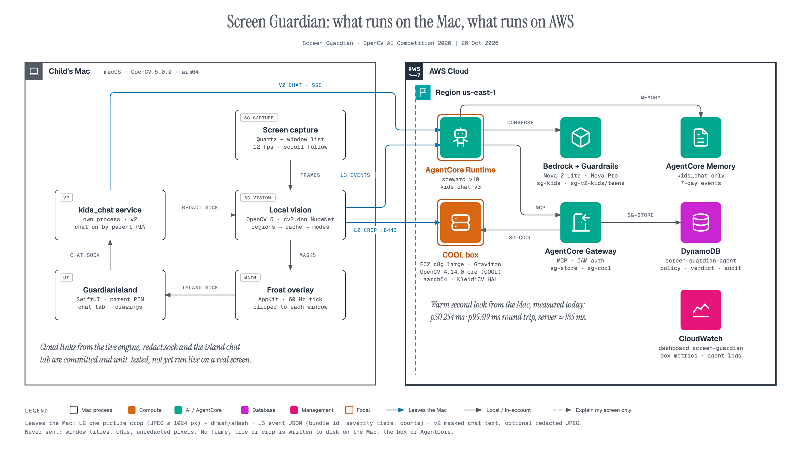


## See it working

**Live, on a real screen.** The island by the notch, recorded while the app ran (cropped to the island so no picture content shows). The test page comes to the front, the character covers its eyes and the island reads **Covering 9**. Switching back to a harmless diagram returns it to **Protecting**.

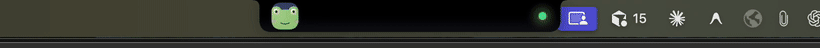

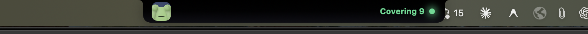
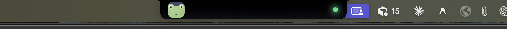

**What the engine covered on that run.** These are mask maps, not screenshots: they draw the regions the engine found and the masks it drew, with no image pixels. The real screenshots stay out of git because the two missed pictures are visible in them.

| Aggressive (kids), COOL on | Medium (teens), cloud off |
| --- | --- |
| 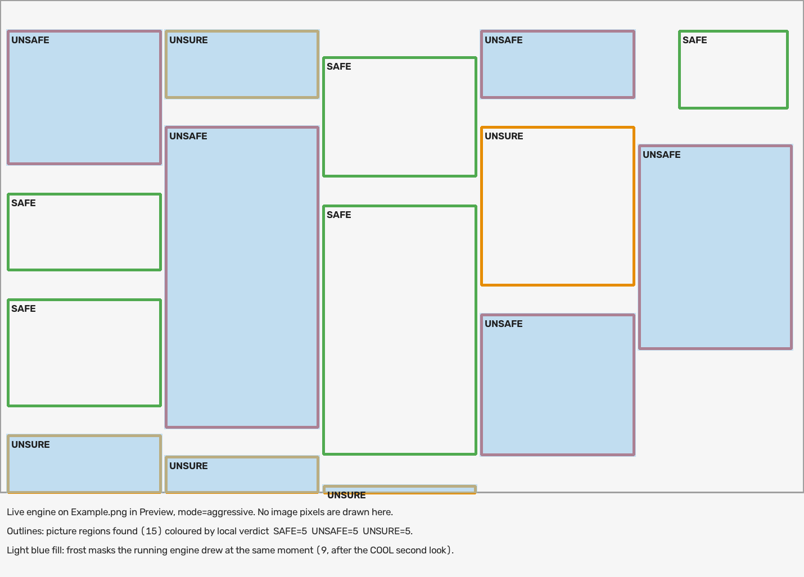 | 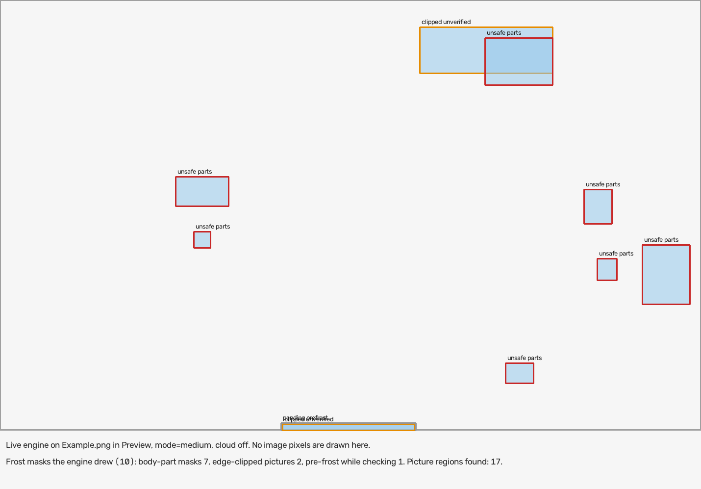 |
| Whole pictures are frosted for UNSAFE; UNSURE pictures stay covered until the second look clears them. | Only body-part boxes are frosted, so the rest of the page stays readable. |

**Modes and window awareness on synthetic test pages.** These run the real engine code with a test oracle in place of the detector. The red outline is the ground truth and the blue outline is the engine's mask.

| Aggressive: whole pictures, masks follow the scroll | Window-aware: menu bar, Dock and front window stay clear | Medium: body-part boxes only |
| --- | --- | --- |
| 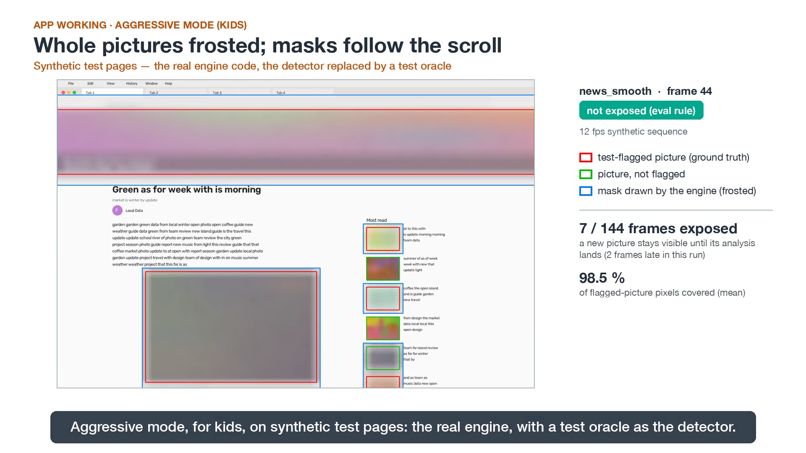 | 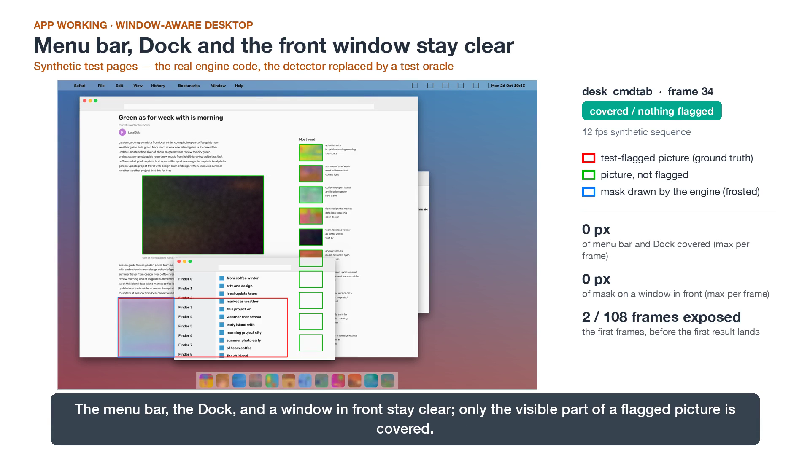 | 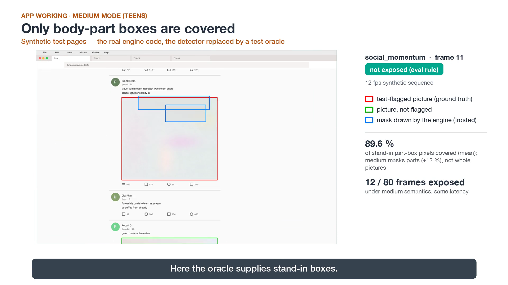 |

**AWS lanes, measured.**

| COOL second look on Graviton (live, 12/12 answered, median 254 ms) | AgentCore steward trace: event → Gateway tools → policy |
| --- | --- |
| 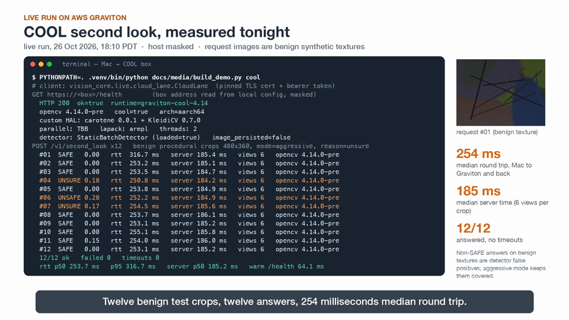 | 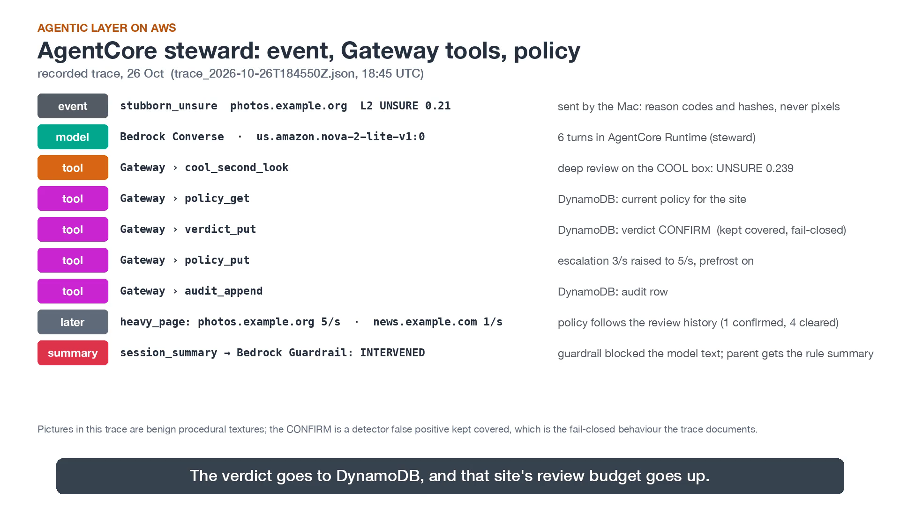 |

**The island.** These were rendered offscreen by the island with sample data, not from a live session.

| Protection tab (parent PIN locks changes) | Kids chat tab (v2) |
| --- | --- |
| 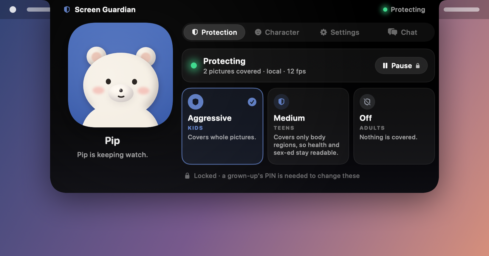 | 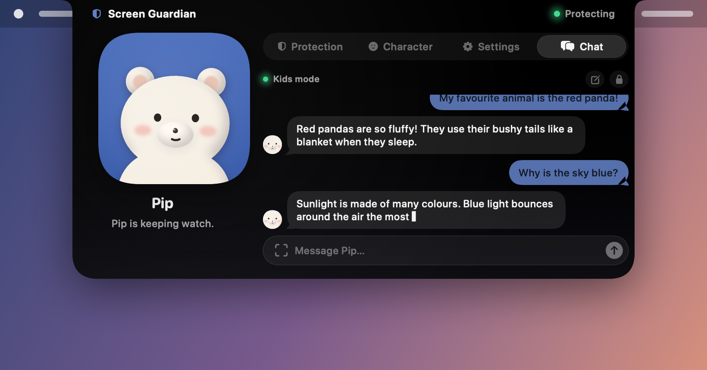 |
| **Parent PIN** | **NOT PROTECTING when capture is unavailable** |
| 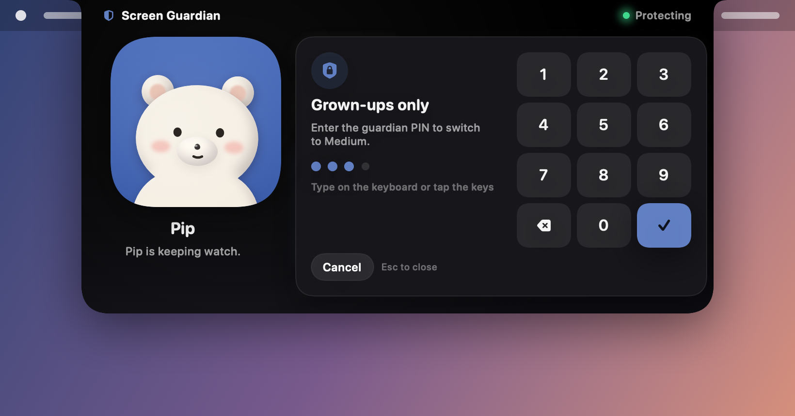 | 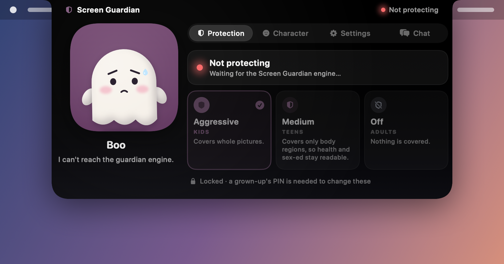 |

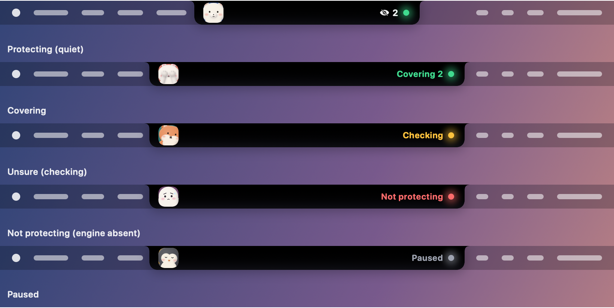

## Protection modes

The parent picks the mode with the island PIN, or you pass `--mode`. The mode is saved in `guardian.json`.

| Mode | For | What is covered | Notes |
| --- | --- | --- | --- |
| `aggressive` (default) | kids | the **whole picture**, for 11 classes (exposed and covered intimate parts, plus exposed male breast and belly); explicit hits are opaque | UNSURE pictures are covered at once, and a second look may clear them. New pictures are pre-frosted before the detector answers. |
| `medium` | teens | **body-part boxes**, unioned per figure, for 5 exposed + 4 covered classes (stricter threshold on covered) | UNSURE gets a second look first. Pre-frost only in "heavy" windows. |
| `off` | adults | nothing | The analyzer idles. Kids chat is disabled. |

In every mode, masks are cut to their own window. The menu bar, the Dock and a window in front are never covered, and there is never a whole-screen blur. Policies are in `policies/live_*.json`, and the full table is in architecture.md §3.

## Quick start

Requirements: an Apple Silicon Mac, macOS 14+, Homebrew Python 3.11 and the Swift Command Line Tools. Run everything from `vision/`. Install packages only into `vision/.venv`.

### 1. Python environment

```bash
cd vision
/opt/homebrew/bin/python3.11 -m venv .venv
source .venv/bin/activate
python -m pip install -r requirements.lock      # exact pins (opencv-python 5.0.0.93, nudenet 3.4.2, onnxruntime, pyobjc, boto3)
python -c "import cv2, platform; print(cv2.__version__, platform.machine())"   # expect: 5.0.0 arm64
```

`requirements.txt` is the loose list. `requirements.lock` is what we test with.

### 2. Screen Recording permission

System Settings → Privacy & Security → **Screen Recording** → enable the app that runs Python (Terminal, iTerm or your IDE). Then quit and reopen that app.

Without it, the engine reports `NOT_PROTECTING` and the island shows the "lost" mood. It never pretends the screen is clean.

### 3. Build the island

```bash
cd island && swift build -c release && cd ..   # → island/.build/release/GuardianIsland
```

The engine starts the island automatically if it is built (`--no-companion` skips it). On first run, the island asks a grown-up to create a **parent PIN**. Changing the mode, pausing or quitting needs that PIN. See [island/README.md](island/README.md), which also has a mock engine for UI work.

### 4. Run the engine

```bash
python -m edge.app --source live --mode aggressive     # or --mode medium / --mode off
```

- **`--mode`.** An explicit `--mode` overrides the saved mode, prints a warning and re-saves it. Leave it out to use the mode the parent set in the island.
- **`--fps`.** Capture runs at 12 fps by default (`--fps`, clamped to 4-15).
- **Quitting.** Ctrl-C quits. A guardian can also quit from the island.
- **What gets written.** Nothing is ever written to disk as an image. The engine log is `~/Library/Logs/ScreenGuardian/engine.log` (no pixels, titles or URLs).
- **Kids chat.** The engine also starts the kids chat service (§Kids chat). `SG_CHAT_SERVICE=0` turns that off.
- **Screen recording.** The frost, island and drawings are hidden from screen recorders by default. `SG_CAPTURABLE=1` makes them visible to recorders, for demo videos.

With no cloud config, everything runs locally and the island shows backend **`local`**.

### 5. Turn on the COOL lane (L2)

Account-specific ids never go in git. Copy `aws.local.example.json` to `aws.local.json` and fill in your box, security group, subnet, VPC and Guardrail ids; `cloud/deploy/box.sh` and `infra/deploy.py` read them from there. Install the leak check as the pre-commit hook: `ln -sf ../../scripts/leakcheck.py .git/hooks/pre-commit`.

The lane needs the box running, your Mac's IP allowed in the box's security group, and three local items. [docs/aws-infra.md](docs/aws-infra.md) §7 and [cloud/deploy/runbook.md](cloud/deploy/runbook.md) cover the box.

```bash
cloud/deploy/box.sh status        # box healthy? (expects OpenCV 4.14.0-pre, cool: true)
cloud/deploy/box.sh sg            # allow this Mac's current /32 on 22 + 8443; remove stale /32s by hand

# once per Mac: pinned cert, bearer token in the Keychain (never in a file)
mkdir -p ~/.screen-guardian
scp -i .secrets/screen-guardian-cool.pem ubuntu@<box-ip>:/home/ubuntu/sg-tls/cert.pem ~/.screen-guardian/l2-cert.pem
security add-generic-password -U -a screen-guardian -s screen-guardian-l2-token \
  -w "$(aws secretsmanager get-secret-value --secret-id screen-guardian/l2-api-token --query SecretString --output text)"
```

`~/.screen-guardian/cloud.json` (no secrets):

### 6. Turn on the AgentCore steward (L3 / L4)

The steward is already deployed (`infra/deploy.py`, outputs in `infra/outputs.json`). The Mac only needs `agent_runtime_arn` in `cloud.json` and AWS credentials in the default profile.

The engine then sends three kinds of event, never pixels, titles or URLs:
- `stubborn_unsure`, when the cloud answer is still UNSURE;
- `heavy_page`, per app at most every 60 s;
- `session_summary`, every 30 min and on quit.

If AgentCore is unreachable, the same steward runs locally with Bedrock, then under fixed rules.

## Kids chat (v2)

Chat lives in the island's **Chat** tab and runs as its own process (`kids_chat.service`, socket `chat.sock`). It is **off by default**.

1. Open the island → Chat → **Grown-ups** (lock icon) → enter the parent PIN.
2. Turn on **Chat**. **Age** defaults to Auto, which follows the mode (aggressive → kids, medium → teens).
3. Optionally turn on **Explain my screen**. It sends one picture with every covered area painted solid gray. It refuses if anything on screen is unchecked.
4. Optionally turn on **Keep transcripts** (on this Mac only; the child sees a badge).

The parent view shows topics and counts, not the child's words. Adults mode always disables chat.

Behind the tab:
- **Backend.** The service uses the AgentCore runtime and guardrails from `kids_chat/infra/outputs.json`, with AWS credentials from the default profile. It falls back to direct Bedrock, then to "I can't chat right now".
- **Run it alone.** `python -m kids_chat.service --verbose`, only when the engine is not running (the engine already starts it, and a second copy refuses the socket).
- **Smoke against the deployed agent.** `python -m kids_chat.scripts.smoke_agent --cross-session` and `python -m kids_chat.scripts.smoke_explain`.
- **Protocol.** [kids_chat/PROTOCOL.md](kids_chat/PROTOCOL.md).

## Tests

```bash
.venv/bin/python -m pytest -q          # 452 passed at the last run (26 Oct)
cd island && swift build -c release    # the island has no XCTest suite; it must build
```

The tests cover the live engine, window clipping, cloud glue, redaction, the island protocol, eval_live and kids chat (`kids_chat/tests/`). The cloud lanes are faked under pytest.

## Repo layout

```
edge/           Mac engine: capture, scroll follow, masks, overlay, island bridge, cloud glue, redact.sock
vision_core/    OpenCV 5 tools; live/ = regions, cache, cv2.dnn detector, modes, analyzer, L2 client
island/         SwiftUI island (Swift package): status, characters, PIN, Chat tab, drawing layer
kids_chat/      v2 chat service, AgentCore agent code, infra/deploy.py, tests
agent/          L3 steward runtime, Gateway tool Lambdas, Mac AgentCore client, Bedrock adapter; replay orchestrator
cloud/          FastAPI for the Graviton box (second look, review), COOL static-graph detector, deploy/
infra/          v1 agent-lane deploy script, outputs, dashboard and guardrail specs
policies/       live_aggressive / live_medium / live_off modes; strict / balanced / relaxed fixture policies
eval_live/      synthetic live-path eval
fixtures/safe/  synthetic colored-shape clip for replay
experiments/    measured runs (cool_live/, agentcore/, eval_live/, replay)
tests/          pytest suite
docs/           report, architecture, AWS, demo script, diagrams/
```

