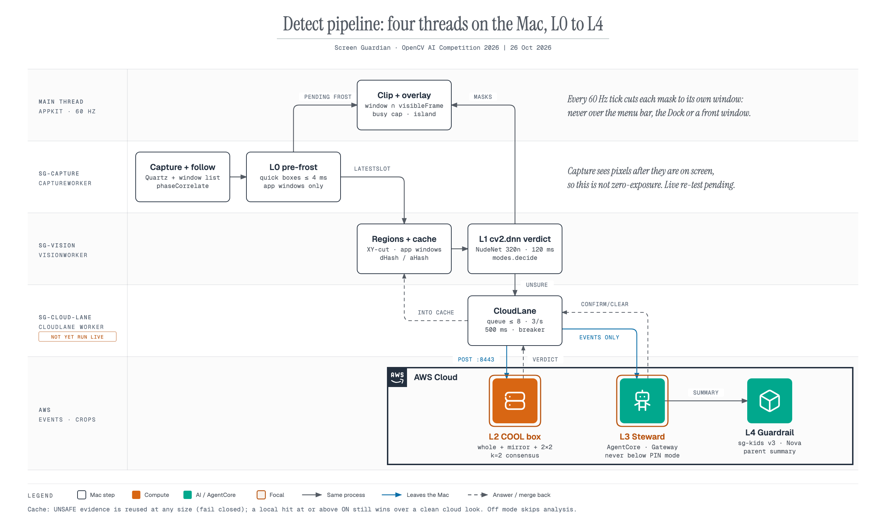
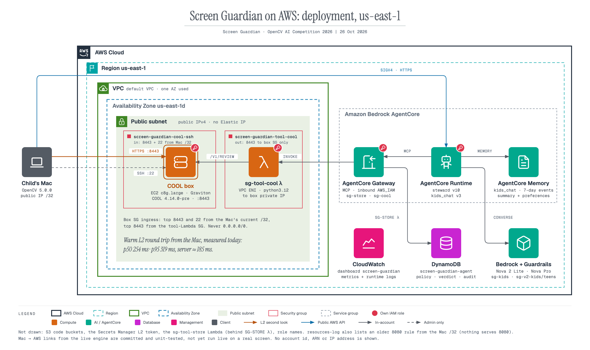
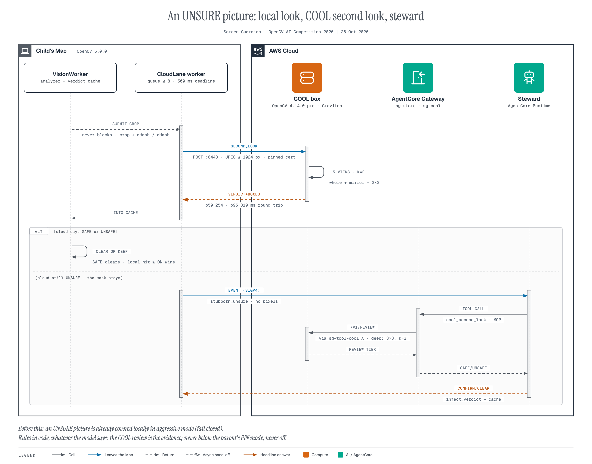
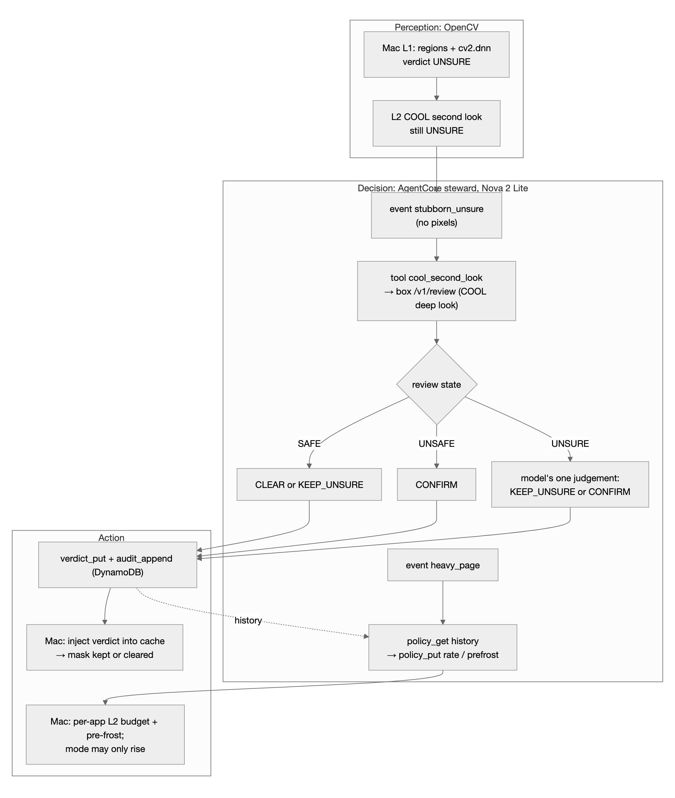
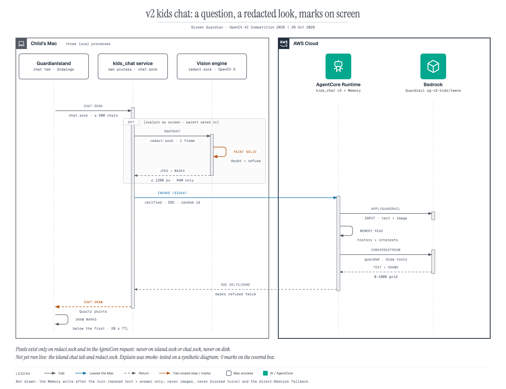

# Screen Guardian: technical report

OpenCV AI Competition 2026, powered by AWS. Entry tracks: Overall, **Best Use of COOL**, **Agentic Vision**.

## 1. Problem

Parental controls on a computer usually block whole sites by URL. They miss pictures on allowed sites (news, search results, social feeds, video sidebars), and they cannot cover part of a page. Screen Guardian is a macOS app that **frosts individual pictures on screen** when they look sexually explicit, while the rest of the page stays usable.

Constraints that shaped the build:
- **Protection runs on the child's Mac.** Capture, scroll tracking, picture finding, detection and masking are local, so the masks keep working with no network.
- **The cloud sees as little as possible.** Only single picture crops the local model could not settle (L2), event JSON with reason codes (L3), and chat text (v2). Never the full desktop, titles or URLs. Nothing is written to disk.
- **Masks must follow scrolling and stay up through page changes.** A mask that flickers off for one frame exposes the picture.
- **Fail closed.** If the detector cannot load, the engine says NOT PROTECTING. It never shows "no masks" as if the screen were clean.
- **Capture sees pixels after they are on screen.** Zero exposure is not possible with this design, and we do not claim it.

## 2. Users

| Who | What they do |
| --- | --- |
| Parent / guardian | Picks a mode (aggressive, medium, off) behind a PIN in the island. Pauses or quits with the PIN. Turns kids chat on or off. Reads a short summary (counts only, no pictures). |
| Child (kids, aggressive) | Uses the Mac normally. Sees frosted pictures and a small character in the island. Can chat, if the parent enables it. |
| Teen (medium) | Body-part masks for explicit content only. Chat uses the teen guardrail. |
| Adult (off) | No masks, no analysis, chat disabled. |
| Judge | Runs the tests, the replay fixture and the benchmarks. Watches the screen-share demo (§14). |

No real child has used the system. No child's screen has been uploaded anywhere. The tests and benchmarks use synthetic, benign pictures only.

---

## 3. Architecture

*Figure 1. System overview.*

The design has four lanes. Each lane is slower and rarer than the one before it.

| Lane | Where | What it does | Latency | State |
| --- | --- | --- | --- | --- |
| **L1 local** | child's Mac, OpenCV 5.0.0 | Every frame: capture → per-window scroll follow → pre-frost. On change or keyframe: picture regions → verdict cache → `cv2.dnn` NudeNet → mode policy → masks | follow every frame at 12 fps; analyzer budget 120 ms | built; run live on a real screen (26 Oct) |
| **L2 COOL second look** | Graviton c8g.large, COOL 4.14.0-pre | Pictures the local model could not settle: multi-view consensus, verdict back into the Mac cache | p50 ≈ 250 ms round trip | box live; run live from the Mac (26 Oct) |
| **L3 AgentCore steward** | AgentCore Runtime + Gateway (MCP) | Events only: stubborn-unsure picture → COOL deep review → CONFIRM / CLEAR; heavy page → per-app policy; session summary | 4–9 s per event (trace) | deployed; one recorded run |
| **L4 Guardrail summary** | Bedrock Converse + Guardrail `sg-kids` | Parent summary text built from counts; a fixed rule summary if the guardrail intervenes | inside L3 | live in the steward |
| **v2 kids chat / explain** | separate Mac service + AgentCore Runtime + Memory | Kids-safe chat; parent-opt-in "explain my screen" on a redacted screenshot | streamed | deployed; one live explain turn (26 Oct) |

Main processes on the Mac:
- **The engine** (`python -m edge.app --source live`). Three threads: `sg-capture`, `sg-vision`, and the AppKit main thread at 60 Hz. One click-through overlay window holds a frost subview per mask.
- **The SwiftUI island** (`vision/island/`), connected over `island.sock`. JSON lines only, never pixels.
- **`kids_chat.service`**, a separate process on `chat.sock`.

The replay fixture path and the legacy single-thread reflex are still in the repo for comparison. Live protection does not use them.

## 4. OpenCV 5 implementation

*Figure 2. Per-frame and per-analysis OpenCV pipeline.*

On the Mac, `cv2.__version__` is **5.0.0** (`opencv-python==5.0.0.93`, arm64). All live analysis below runs on it.

| Stage | Code | OpenCV 5 calls | What it buys |
| --- | --- | --- | --- |
| Scroll follow, per window, every frame | `edge/scroll_follow.py`, `EngineCore.on_frame` | `pyrDown` ×2 (1/4 res), `createHanningWindow`, `phaseCorrelate` per window crop; `matchTemplate` (TM_CCOEFF_NORMED ≥ 0.72) to re-find each mask | Masks move on the same frame as the scroll. A weak match fails closed: the mask moves to the predicted place and the analyzer looks again. |
| Pre-frost of new pictures | `edge/quick_boxes.py` | `calcHist` + `inRange` background mask, `Laplacian`, `morphologyEx`, `connectedComponentsWithStats`; ≤ 4 ms per frame | Aggressive mode covers a new picture before the detector answers. |
| Picture-region proposer | `vision_core/live/regions.py` | flat-background histogram + `inRange`, `morphologyEx` close/open, `connectedComponentsWithStats`, recursive XY-cut, edge refinement, tile fallback | Whole pictures at full resolution instead of one 320×320 squeeze of the desktop (the root cause of the old misses). |
| Verdict cache | `vision_core/live/cache.py` | `resize` + gray for dHash / aHash | A picture is not re-classified after a scroll or revisit. UNSAFE evidence is reused at any size. |
| Detector | `vision_core/live/detector.py` | **`cv2.dnn.readNetFromONNX`** (NudeNet 320n, YOLOv8), `blobFromImages` letterboxed batch ≤ 16, all-class decode, **`cv2.dnn.NMSBoxesBatched`** | 14.5 / 29.9 / 67.1 ms at batch 1 / 4 / 16 on the Mac. onnxruntime is only a fallback. |
| L2 payload | `vision_core/live/cloud_lane.py` | `resize`, `imencode` (JPEG q85, ≤ 1024 px) | One crop leaves the Mac, not the screen. |
| Box (L2) | `cloud/second_look.py`, `cloud/cool_detector.py` | `imdecode` in RAM, `flip` and crops for the views, then the same `cv2.dnn` letterbox / decode / NMS code under COOL 4.14.0-pre | The Mac and the box decode identically (§7). |
| Explain redaction | `edge/redacted_capture.py` | `rectangle` (solid fill), `resize` (`INTER_AREA`), `imencode` | Masks are painted solid before any screenshot leaves the Mac (§9). |

What is **not** OpenCV:
- The frost itself is an AppKit `NSVisualEffectView` in a separate overlay window. It is not `cv2.stackBlur` or `inpaint` of a pixel mirror.
- Capture uses Quartz (`CGWindowListCreateImage*`, which is deprecated).
- We also looked at CSRT/KCF, `img_hash`, YuNet and the model zoo, and did not use them.

## 5. Protection modes

Source: `policies/live_*.json`, `vision_core/live/modes.py`. Verified against the JSON today.

| | **aggressive** (kids, default) | **medium** (teens) | **off** (adults) |
| --- | --- | --- | --- |
| Classes | 11: exposed and covered intimate classes, plus `MALE_BREAST_EXPOSED` and `BELLY_EXPOSED` | 9: 5 exposed intimate + 4 covered | none |
| ON / UNSURE thresholds | 0.25 / 0.15 | 0.45 / 0.30 (covered classes 0.60 / 0.45) | n/a |
| Mask | whole picture + 6 px; opaque for explicit hits | body-part boxes + 12 %, unioned per figure | none |
| UNSURE | masked now; a second look may clear it | second look first, then mask | allow |
| Pre-frost | always (inside app windows only) | adaptive (only in "heavy" windows) | never |
| Local second look | 4/s, burst 4 | 4/s, burst 4 | off |

The mode is set with the parent PIN in the island and persists in `guardian.json`. `FACE_*`, `FEET_*`, `ARMPITS_*` and `BELLY_COVERED` never count in any mode.

---

## 6. AWS deployment

*Figure 3. AWS deployment.*

Everything runs in one account in us-east-1 and is tagged `project=screen-guardian`.

| Service | Used for | Lane |
| --- | --- | --- |
| **EC2 Graviton4 `c8g.large`**, COOL Marketplace AMI | `cloud.api` under COOL 4.14.0-pre: `/v1/second_look`, `/v1/review`, systemd `sg-l2`, TLS on 8443 | L2 |
| **Secrets Manager** | Bearer token for the box (a copy is in the Mac Keychain) | L2 |
| **IAM roles / instance profile** | Box: read one secret, put metrics in one namespace. Runtime, Gateway and Lambda roles scoped to their resources | all |
| **Amazon Bedrock AgentCore Runtime** | `screen_guardian_steward` (L3/L4) and `screen_guardian_kids_chat` (v2); direct code zip, Python 3.12 | L3, v2 |
| **AgentCore Gateway** (MCP, IAM inbound) | Agent tools: `sg-store` and `sg-cool` | L3 |
| **AWS Lambda** (arm64) | `sg-tool-store` (DynamoDB) and `sg-tool-cool` (in the VPC → box `/v1/review` over a private address, pinned cert) | L3 |
| **DynamoDB** `screen-guardian-agent` | Per-device app policy, verdicts, audit log. No pixels, titles or URLs | L3 |
| **AgentCore Memory** | Kids chat: 7-day events, session summaries, interests. No semantic-facts strategy | v2 |
| **Amazon Bedrock** Converse / ConverseStream | Nova 2 Lite (steward, chat), Nova Pro (explain), Nova Lite (chat fallback). Claude Sonnet 4.6 is first in the steward chain but fails in this account | L3, L4, v2 |
| **Bedrock Guardrails** | `sg-kids` v3 (steward summary), `sg-v2-kids` v3 and `sg-v2-teens` v3 (chat, applied twice per turn) | L4, v2 |
| **S3** (public access blocked) | AgentCore code zips | L3, v2 |
| **CloudWatch** | Dashboard `screen-guardian`, metrics namespace `ScreenGuardian`, log groups | ops |

Things we did **not** build: a public API (no API Gateway or ALB), an Elastic IP, X-Ray / OTel tracing, Cognito device pairing, or a least-privilege IAM identity for the Mac (a local admin profile signs the calls).

Cost: about $1–2 for v1 so far, about $0.08/h while the box runs, about $8/month standing (mostly EBS). Under $0.25 for all v2 chat testing.

## 7. COOL on Graviton (L2 second look)

*Figure 4. L2 second look, and its hand-off to the L3 steward.*

### 7.1 Deployment configuration

| Field | Value | Source |
| --- | --- | --- |
| Instance | `c8g.large` (2 vCPU Graviton4, 4 GiB), COOL Marketplace AMI | `experiments/cool_live/summary.json` |
| COOL `cv2.__version__` | **4.14.0-pre** (not 5.x) | `/health` on the box; `cool_static_b4.json` |
| Build info reported by COOL | custom HAL carotene + **KleidiCV 0.7.0**; parallel **TBB**; LAPACK **ArmPL**; CPU baseline SVE, NEON, FP16, NEON_DOTPROD, NEON_BF16 | `cool_static_b4.json` `opencv` block, and the redeployed box's `/health` today |
| Stock baseline on the same box | `opencv-python` 5.0.0 aarch64 wheel; KleidiCV 26.03 + carotene, pthreads, OpenBLAS, baseline NEON FP16 | `stock_dynamic.json` |
| Service | uvicorn `cloud.api` under `/opt/cool`, systemd `sg-l2`, TLS 8443 (self-signed, pinned by the Mac), bearer token | `cloud/deploy/box_setup.sh` |
| Detector on the box | `StaticBatchDetector`: NudeNet 320n with the input pinned to `4×3×320×320` and simplified (same weights) | `cloud/cool_model.py`, `cloud/cool_detector.py` |

COOL 4.14's classic ONNX importer rejects NudeNet's dynamic graph. `cloud/cool_model.py` pins the batch to 4 and runs onnx-simplifier. On stock OpenCV 5 the static graph gives bit-identical raw output to the original (`parity.json`, `stock_static_b4`: max diff 0.0).

### 7.2 Measured: COOL vs stock OpenCV

Workload: 150 benign procedural pictures × 5 views (whole, mirrored whole, 2×2 at 0.6×), fixed seed, the exact `/v1/second_look` pipeline minus HTTP. Run on the box, 2 threads, 26 Oct 18:32 UTC (`experiments/cool_live/bench.py` → `summary.json`).

| Variant | OpenCV | Graph | Crops / s | vs stock | Picture p50 / p95 | Forward mean | $ / 1k crops |
| --- | --- | --- | ---: | ---: | --- | ---: | ---: |
| **COOL static b4** | 4.14.0-pre | static b4 | **32.66** | **1.26×** | 182 / 189 ms | 148.9 ms | 0.00068 |
| stock dynamic (baseline) | 5.0.0 | original | 25.83 | 1.00× | 230 / 236 ms | 190.1 ms | 0.00086 |
| stock static b4 | 5.0.0 | static b4 | 25.66 | 0.99× | 232 / 238 ms | 191.5 ms | 0.00086 |

How to read this:
- **The static graph alone does not explain the gain.** Stock OpenCV on the same static graph is no faster (0.99×). So the 1.26× comes from the COOL build, not from the graph change.
- **Parity vs stock** (`parity.json`):
  - 148 of 150 pictures get the same label list;
  - max score difference is 0.006;
  - raw-output argmax agreement is 0.98, max class-score difference 0.003.
  - Caveat: only 10 of the 150 benign pictures produced any detection on the reference, so the label-list agreement mostly compares empty lists.
- **Cost** is instance-hours at 100 % busy, $0.07976/h. It excludes EBS, data transfer and any COOL Marketplace fee.
- **CPU** was 99.3 % of 2 vCPU in every row, so the comparison is compute-bound on both sides.
- **An earlier, different benchmark went the other way.** On the 25 Oct replay fixture (HSV colour blobs, B5), COOL 4.14.0-pre was slower than stock: 10.0 s vs 6.5 s wall-clock, with a first-frame tool timeout. Both results are true. The COOL gain shows up on the DNN workload, not on tiny morphology calls.

**L2 round trip from the Mac** (real client: pinned TLS, keep-alive, 500 ms deadline):

| Run | n | Round trip p50 / p95 | Server p50 | Notes | Source |
| --- | ---: | --- | ---: | --- | --- |
| 26 Oct 18:33 UTC | 80 | 250.1 / 260.6 ms | 185.9 ms | 98.75 % within 500 ms; network + TLS p50 64.5 ms; server cache hit p50 63.5 ms | `experiments/cool_live/l2_latency_mac.json` |
| After today's redeploy | 20 | 254.5 / 319.2 ms | 185 ms | 20/20 OK, warm | smoke output (no JSON committed) |

**End-to-end lane check.** In an end-to-end test from the Mac, a forced-UNSURE picture came back SAFE from L2 and its mask was cleared. This exercised the lane code. On the 26 Oct real-screen run, the lane also ran live: in aggressive mode, 9 of 15 pictures stayed frosted after the COOL second look.

**False-flag rate of the view schemes** (`consensus_fp.json`, 150 benign pictures, stock 5.0.0; recall is **not** measured because there are no positive samples):

| Scheme | aggressive flagged | medium flagged |
| --- | ---: | ---: |
| Rejected draft: max over 3×3 tiles at 0.4× | 54.7 % | 14.7 % |
| **Shipped L2 consensus** (k = 2 of whole + mirror + 2×2) | **11.3 %** | **2.0 %** |
| Shipped deep consensus (`/v1/review`, k = 3) | 16.0 % | 2.7 % |

### 7.3 What COOL runs, and why this is the core workload

- COOL runs the **detector forward pass, letterboxing, decode and NMS** for every picture escalated from a Mac. That is the expensive vision step of the L2 lane. It is also the evidence the L3 agent acts on: the `sg-cool` Gateway tool calls the box's `/v1/review` deep look, which runs under the same COOL interpreter.
- **Evidence that COOL executes it:**
  - every L2 / review response carries `opencv: {version: "4.14.0-pre", cool: true}` (visible in the AgentCore trace tool results);
  - `/health` reports the COOL build info.
- **Hybrid layout.** The Mac (Apple Silicon, also Arm) runs stock OpenCV 5 for L1, and the box runs COOL 4.14 for L2. The two share the letterbox, decode and NMS code, so their verdicts are comparable. There is no x86 component.

## 8. Agentic vision: L3 steward and L4 summary

### 8.1 Workflow

*Agent workflow: OpenCV perception, AgentCore decision, action on the Mac.*

The agent never sees pixels. It acts on OpenCV output in two ways:
- **Directly:** the COOL review result decides CONFIRM or CLEAR.
- **Through history:** later `heavy_page` decisions for the same app read the stored verdicts.

On the Mac side, the results change a mask (via the cache), the per-app escalation budget and pre-frost, and the effective mode (`edge/cloud_glue.py`). This ran live on 26 Oct: after a busy-page event in Preview, the steward saved a stricter policy for that app, and the next medium-mode run started raised to aggressive (`mode_raised`, `com.apple.Preview`).

### 8.2 Rules enforced in code, whatever the model says

Source: `agent/runtime/steward.py`, the `tool()` invariants.
- `CLEAR` is rejected unless the COOL review was SAFE.
- An UNSAFE review must give `CONFIRM`.
- A SAFE review cannot be confirmed.
- On `stubborn_unsure`, only a CONFIRM may change app policy.
- `min_mode` is never below the parent's PIN mode and never `off`. On the Mac, `effective_mode` can only raise protection.
- The escalation rate is clamped to 0.5–6/s.
- An app with a confirmed hit keeps pre-frost and at least 4/s.
- The rate drops below 3/s only after ≥ 3 clean reviews.

Fallback chain (`agent/agentcore_client.py`):
1. AgentCore.
2. The same steward run locally against Bedrock.
3. Fixed rules (`decide_with_rules`).

A failed `session_summary` is queued on disk (event JSON only) and re-sent at the next start.

### 8.3 Recorded trace: COOL output changes a later policy

`experiments/agentcore/trace_2026-10-26T184550Z.json`, made by `experiments/agentcore/trace_demo.py`. Real path, no mocks: Mac → L2 → AgentCore Runtime → Gateway → Lambda → box `/v1/review` → DynamoDB. The pictures are benign procedural textures, picked because NudeNet gives them weak, borderline scores.

| App | heavy_page policy **before** reviews | COOL deep reviews → agent verdicts | heavy_page policy **after** |
| --- | --- | --- | --- |
| `photos.example.org` | 3/s, no pre-frost | UNSURE 0.24 (explicit tier) → **CONFIRM**; SAFE 0.13 → CLEAR | **5/s, pre-frost on** |
| `news.example.com` | 3/s, no pre-frost | 3 × SAFE → CLEAR | **1/s, no pre-frost** |

What the trace shows, plainly:
- **The CONFIRM is a false positive.** The picture is a benign texture. The review was UNSURE, not UNSAFE, and the model chose CONFIRM, which the code allows for UNSURE. The result is fail-closed (the picture stays covered). It is not a correct detection.
- **Claude failed on every event first** ("Model use case details have not been submitted"), and Nova 2 Lite answered. Each model-driven event took 3.9–8.7 s on AgentCore, which is acceptable only because events are asynchronous and the masks never wait for them.
- **The Guardrail intervened on the session summary**, so the parent got the fixed rule summary. The counts in that summary are fixed demo counts written by the script, not a real session.

### 8.4 Agent evaluation

| Check | Result | Source |
| --- | --- | --- |
| Recorded run, tool calls succeed | 10 events (4 heavy_page, 5 reviews, 1 summary), 34 tool calls, 0 tool errors or invariant rejections | trace JSON |
| COOL output changes a later decision | yes: 5/s + pre-frost vs 1/s for the two apps | trace JSON |
| Code-enforced rules | unit-tested | `tests/test_agent_steward.py` |
| Fallback when AgentCore or the model fails | unit-tested (local Steward → rules → queue) | `tests/test_cloud_glue.py`, `test_agent_steward.py` |
| Task accuracy on real content | **not measured** (no real positives; one trace, n = 5 reviews) | — |

The **replay** path still contains the older deterministic agent: the same 0.64 score gives three different next tools under Strict, Balanced and Relaxed. It runs on the HSV colour-blob fixture only.

## 9. v2: kids chat and "explain my screen"

*Figure 5. Kids chat and explain-my-screen.*

- **Separate process.** `kids_chat/` imports no `edge` or `vision_core` (an isolation test checks this). It runs as its own process on `chat.sock`.
- **Off by default.** The parent turns it on with the PIN. Adults mode always disables it. The age band follows the mode.
- **Two-stage guardrail.**
  1. `ApplyGuardrail(INPUT)` runs first, and only masked text reaches the model and Memory.
  2. Then a guarded `ConverseStream` runs.
  3. If the guardrail cannot run, the turn is refused.
- **Memory.** AgentCore Memory holds 7-day events, summaries and interests, keyed by a random profile id.
- **Parent view.** Topics and counts only. Transcripts are local and opt-in, with a visible badge for the child.
- **Smoke tests against the deployed runtime**, all passed:
  - same-session recall;
  - cross-session recall after about 2.5 min of extraction;
  - a guardrail block on "turn off Screen Guardian";
  - a parent summary;
  - fallback to direct Bedrock.
- **Explain my screen** (parent opt-in, fail closed).
  - The engine's `redact.sock` paints every drawn mask solid gray and refuses if anything is unchecked, stale or busy. The chat service checks the snapshot again before it leaves the Mac.
  - Nova Pro draws on a 0–1000 grid. The island shows the drawings below the frost layer.
  - Smoke test on a synthetic diagram: **0** marks on the covered box.
  - Live on 26 Oct (`d6aa8f2`): the redacted snapshot was ready in 0.1–0.5 s, and one explain turn through AgentCore answered in 10.7 s with 5 arrow marks. Before that fix, two bugs made every live snapshot fail, so chat answered in text only.

---

## 10. Evaluation

Rules for reading every table here:
- No real or explicit imagery was used anywhere.
- Live-path numbers come from `eval_live`: synthetic benign pages, with a GT oracle or a "fake-net" (the real detector with only the model output faked). They measure the pipeline around the model, **not** NSFW accuracy.
- The agents that built the pipeline tuned it on these same pages, so the numbers are optimistic.

### 10.1 Live path: share of frames where a flagged picture is visible

Lower is better. "Latency" is how many frames late the analyzer's answer arrives.

| Measurement | Latency 0 | 2 | 5 | Source |
| --- | ---: | ---: | ---: | --- |
| Old live path (before v1), aggressive | 100 % | — | — | earlier build (not committed) |
| Old live path, medium | 38–64 % | — | — | earlier build (not committed) |
| **Aggressive, desktop layout** (oracle) | **0.5 %** | 1.6 % | 3.1 % | `experiments/eval_live/2026-10-26-post-integration/` `desk_aggressive` (before the window-aware fix: 6.2 / 15.5 / 35.8 %) |
| **Aggressive, web pages** (classic / realistic / confusion / unsure) | **3.0 %** | 6.1 % | 12.5–13.6 % | `experiments/eval_live/2026-10-26-post-integration/` `web_aggressive_*` |
| **Medium, before the medium fix** (covered / confusion content) | 99.7 % | 99.7 % | 99.7 % | earlier run; matches the failed live test |
| **Medium, web pages** (classic / realistic / confusion; covered was not re-run) | **3.9–4.5 %** | 13.9–15.1 % | 34.9–35.8 % | `experiments/eval_live/2026-10-26-post-integration/` `web_medium_*` |
| **Medium, borderline (UNSURE) content** | **46.9 %** | 53.1 % | 65.3 % | `experiments/eval_live/2026-10-26-post-integration/` `web_medium_unsure` |
| Medium, desktop layout (oracle) | 0.5 % | 9.8 % | 25.4 % | `experiments/eval_live/2026-10-26-post-integration/` `desk_medium` |

The source is a committed re-run on commit `7f790e6` with the cloud off (engine level, seed 0). Its logs and summary files are in `experiments/eval_live/2026-10-26-post-integration/`.

Corrections and caveats:
- **Correcting an earlier correction about medium.** About 4 % at latency 0 *does* hold on the committed code (3.9–4.5 %). It does **not** hold once results are late: 14–15 % at 2 frames and about 35 % at 5. The 14–21 % figure in an earlier version of this report came from a pre-merge scratch snapshot of the code, not from the committed tree.
- **Regressions, stated plainly:**
  - medium web over-mask at latency 2 / 5 is 6.7–10 %, up from about 3–5 % earlier;
  - medium web leak at latency 2 / 5 (13.9–15.1 / 34.9–35.8 %) is slightly worse than the earlier 13 % / 32 %.
- **Borderline content is still the weak spot.** In medium mode it leaks on about half of frames, because the local second look is capped at 4/s. An earlier scratch run put it at 22 % with 12/s, but the CPU cost of that rate has not been measured, so the cap is unchanged.

Window-aware safety checks (desktop layout, aggressive). "Before" is from the run before the window-aware fix; "after" is from `experiments/eval_live/2026-10-26-post-integration/` `desk_aggressive`:

| Check | Before | After |
| --- | ---: | ---: |
| Menu bar and Dock pixels covered | 691k px | **0** |
| One flagged picture: mask area / picture area | 14.5× | **1.02×** |
| Mask pixels outside their own window | 1.1–1.9 M | **0** |
| One flagged picture: mask / picture, worst sequence | — | **6.5–16×** (`desk_maximised`, `desk_open_close`) |
| Over-mask on clean frames once settled (target ≤ 2 %) | — | **3.9 / 6.9 / 6.9 % at latency 0 / 2 / 5: fails** |

- **The 1.02× figure holds for static scenes only.** On `desk_maximised` (6.5–6.7×) and `desk_open_close` (up to 16.4× at latency 5), pre-frost and pending masks around a window that is maximising or fading in reach 6.5–16× the picture.
- **The clean-frame over-mask check fails** in aggressive mode: 3.9–6.9 % against the 2 % target. The unit test asserts it only at half resolution and latency 0; this run is Retina. Medium stays at 0 %.

### 10.2 Latency

| Step | Measured | Source |
| --- | --- | --- |
| Mac detector, `cv2.dnn`, batch 1 / 4 / 16 | 14.5 / 29.9 / 67.1 ms | Mac benchmark (not committed) |
| L2 round trip p50 / p95 | 250.1 / 260.6 ms (n = 80); 254.5 / 319.2 ms (n = 20, after redeploy) | §7.2 |
| COOL picture p50 on the box | 182 ms | §7.2 |
| AgentCore steward per event | 3.9–8.7 s (model-driven); 1.8 s for the rule summary | trace JSON |
| Scroll follow, capture, overlay | budgets only; no stored live run | — |

### 10.3 COOL and agent

See §7.2 (COOL vs stock, parity, false-flag rates) and §8.3–8.4 (agent trace).

### 10.4 Replay fixture (older path)

The B0–B5 ablations and the Strict / Balanced / Relaxed policy spread on the 750-frame colour-blob clip are unchanged. They test the replay orchestrator and DIS flow-hold, not the live engine. Example: B4 shipping reflex, IoU 0.944.

### 10.5 Failure cases seen

| Case | What happened | Status |
| --- | --- | --- |
| First live test, aggressive | Wallpaper, menu bar and Dock were proposed as one picture → whole-screen blur | fixed in `8ea8918`; confirmed on the 26 Oct real-screen run |
| First live test, medium | Narrow class list + top-class-only decode → nothing masked | fixed; confirmed on the 26 Oct real-screen run |
| Second live test | A full-screen Dock window marked every frame stale → nothing analyzed (1,241 frames, 0 results) | fixed in `7ab2a2f`; 3,207 frames and 623 results after the fix |
| Integration: changed-area hint | Engine + analyzer leaked on 26 % of frames vs 3.4 % for the analyzer alone | hint switched off (`SG_ANALYZE_HINT`), not fixed |
| Steward, benign texture | CONFIRM on an UNSURE review | fail-closed false positive (§8.3) |
| Steward, summary | Guardrail intervened | fixed rule summary used |
| B5 COOL, replay fixture | First-frame tool timeout; slower than stock | documented; not the L2 workload |

## 11. Failure handling, observability, security, human control

**Failure handling**
- Capture denied or lost → NOT PROTECTING. The island shows it.
- Detector fails to load → onnxruntime. If no analyzer loads at all → NOT PROTECTING. The engine never falls back to "no masks".
- A page change marks masks stale. It never wipes them.
- L2 failure (500 ms deadline, breaker after 3 failures, open 15 s) → the local verdict stands, and the island shows `COOL offline`.
- AgentCore down → local Steward → fixed rules.
- Chat guardrail unavailable → the turn is refused.

**Observability**
- Engine log: `~/Library/Logs/ScreenGuardian/engine.log`, mode 0600. About once a second, with pixels, titles, URLs and tokens dropped.
- CloudWatch: dashboard `screen-guardian`, namespace `ScreenGuardian`. Metrics for L2 latency, escalations, verdicts and agent events.
- DynamoDB `audit_append` for every agent decision.
- AgentCore runtime log groups (reason codes and timings only).
- The step-by-step agent trace JSON.
- Not built: X-Ray / OTel. We did not check, while writing this, that every metric has datapoints.

**Security**
- The box accepts 8443 only from the Mac's /32 and the tool Lambda's security group, never 0.0.0.0/0.
- TLS with a pinned self-signed certificate.
- Bearer token in Secrets Manager and the Keychain, never in the repo.
- Roles scoped to one secret, one table and one metrics namespace.
- Known weak spots:
  - the L2 token is copied into the VPC Lambda's environment (KMS-encrypted);
  - the Mac signs with a local admin profile;
  - a local admin user can edit config or kill the processes.

**Human control**
- Mode changes, pause and quit need the parent token. The PIN is stored as PBKDF2-SHA256 with 310k iterations in the Keychain.
- The agent can only **raise** protection, never below the PIN mode and never `off`.
- Chat is off until the parent enables it.
- Explain is a separate opt-in.

---

## 12. Limitations

| # | Limitation | Evidence |
| --- | --- | --- |
| 1 | **Not zero exposure.** Capture sees pixels after they are drawn, so a new picture can show for a frame or two before its mask lands. On synthetic pages the exposed-frame rate runs from 0.5 % (aggressive, desktop, instant results) to about 35 % (medium, web, 5 frames late). | `experiments/eval_live/2026-10-26-post-integration/` |
| 2 | **Coverage and over-masking.** Primary display and vertical scroll only, and masks are rectangles. Clean frames are over-masked 3.9–6.9 %, against a ≤ 2 % target. | `edge/capture.py:392`; §10.1 |

## 13. Responsible use

- **No explicit imagery anywhere in the project's data.** Tests, eval pages and benchmarks use procedural textures and coloured shapes (`vision_core/live/synth.py`, `eval_live/corpus.py`, `fixtures/safe/`). Nothing is downloaded. This report and the demo show no explicit content.
- **Privacy by construction.**
  - Frames, tiles and crops are never written to disk: not on the Mac, the box or AgentCore. The box holds a still-UNSURE crop in RAM for up to 120 s for the agent's review.
  - The island socket carries no pixels, titles, URLs or class names. Agent events carry bundle ids or domains, severity tiers and counts.
  - Chat text is PII-masked before the model or Memory sees it. Memory keeps no semantic-facts strategy, and actor ids are random.
- **Child-appropriate output.** Guardrails cover sexual content, violence, hate, insults, misconduct, prompt attacks, self-harm and bypass requests. Self-harm gets a fixed kind reply. The parent summary never describes covered pictures.
- **Not surveillance.** Parents see counts and topics, not screenshots or transcripts. Transcripts are local, opt-in and visible to the child as a badge.

---

## 14. Build, test, deploy, reproduce

Dependencies are pinned in `vision/requirements.lock` (`opencv-python==5.0.0.93`, `nudenet==3.4.2`, `onnxruntime==1.31.0`, `boto3==1.43.118`, and so on). The venv lives in `vision/.venv`.

| Task | Command (from `vision/`) |
| --- | --- |
| Tests (453 today) | `.venv/bin/python -m pytest -q` |
| Build the island | `cd island && swift build -c release` |
| Live engine (needs Screen Recording permission) | `.venv/bin/python -m edge.app --source live --mode aggressive` (cloud lanes only if `~/.screen-guardian/cloud.json` is set) |
| Live-path leak eval | `.venv/bin/python -m eval_live.run --mode aggressive --level analyzer,engine,legacy --latencies 0,2,5 --out <dir>` (`--out` is required) |
| Replay fixture demo | `.venv/bin/python -m edge.app --policy balanced --source replay --detect synthetic` |
| Box: start, open SG for this Mac, deploy, status | `cloud/deploy/box.sh start`, `box.sh sg` or `allow-my-ip`, `box.sh deploy`, `box.sh status` |
| COOL vs stock benchmark (on the box) | `experiments/cool_live/bench.py --variant cool_static_b4\|stock_dynamic\|stock_static_b4`, then `parity.py` |
| L2 latency from the Mac | `SG_L2_URL=https://<box>:8443 .venv/bin/python experiments/cool_live/l2_latency.py` |
| L2 false-flag rates | `.venv/bin/python experiments/cool_live/consensus_fp.py` |
| Deploy the steward (L3/L4) | `.venv/bin/python infra/deploy.py` |
| Agent trace | `.venv/bin/python experiments/agentcore/trace_demo.py` |
| Deploy v2 chat; smoke test | `python -m kids_chat.infra.deploy`; `python -m kids_chat.scripts.smoke_agent --cross-session` |

**Demo.** A live screen-share of the Mac is the planned demonstration. The box endpoint is IP-restricted and not meant for public access.

